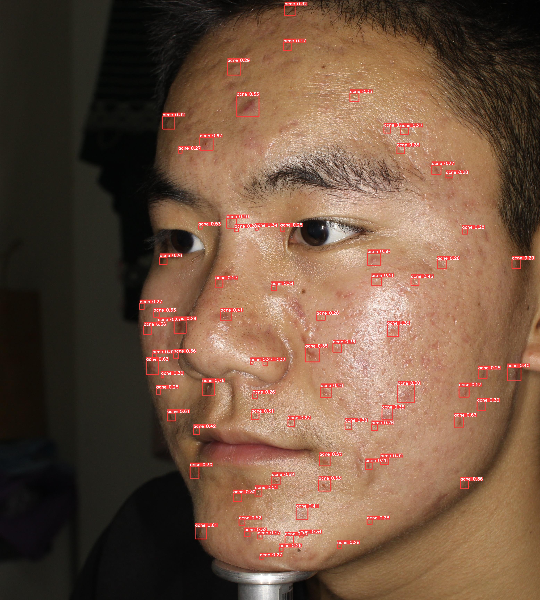
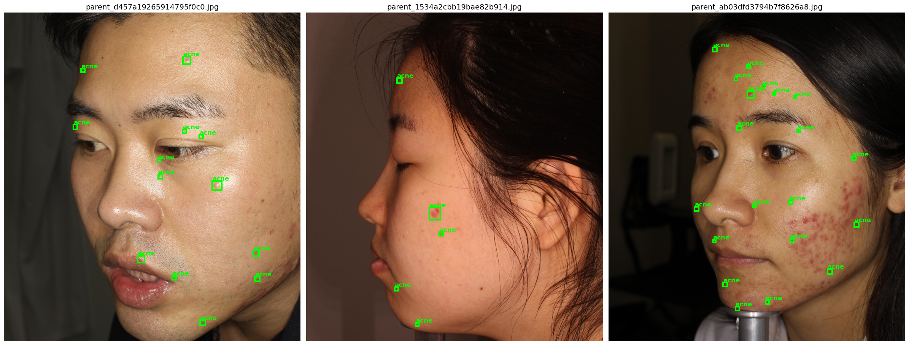
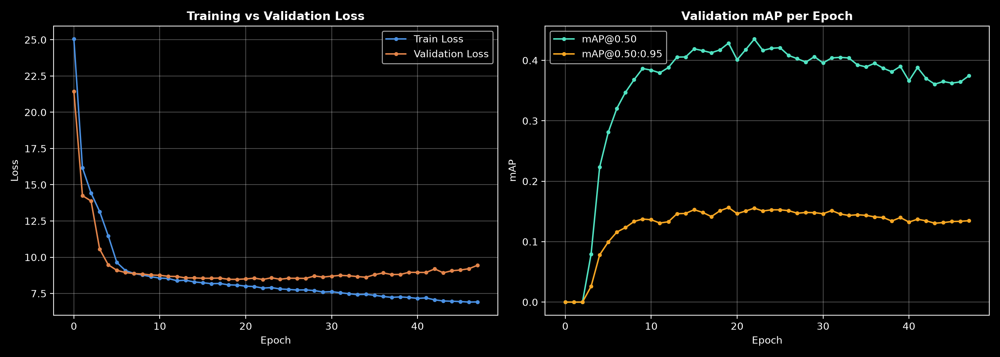
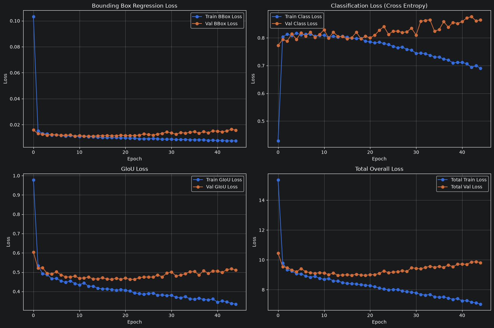

# RF-DETR Acne Detection: High-Resolution Facial Acne Lesion Detection

[](https://www.python.org/)
[](https://pytorch.org/)
[](https://github.com/roboflow/rf-detr)
[](https://github.com/obss/sahi)
[-purple.svg)](https://modal.com/)
[](LICENSE)

An end-to-end deep learning framework for class-agnostic facial acne lesion detection using **RF-DETR-L (Receptive-Field DETR Large)** combined with **SAHI (Slicing Aided Hyper Inference)**. This repository provides complete pipelines for full-resolution dataset conversion to COCO format, cloud-scale distributed training on [Modal.com](https://modal.com), comprehensive loss & mAP evaluation telemetry, and ultra-high-resolution sliced inference capable of locating tens to hundreds of tiny acne lesions on full-face photography.

---

## Visual Detection Results

### 1. High-Resolution SAHI Sliced Inference on Full Face Portrait
Using our best trained RF-DETR-L model with SAHI (1024x1024 slice size, 20% overlap, and Non-Maximum Merging), the model successfully pinpoints **80 distinct acne lesions** across the forehead, cheeks, nose, and chin:

<p align="center">
  
</p>

### 2. Dataset Ground Truth Annotations (COCO Format)
Random sample parent images from the Acne04v3 dataset converted to COCO bounding box format:

<p align="center">
  
</p>

---

## Key Performance Metrics

The model was evaluated against validation sets using standard COCO mean Average Precision (mAP) metrics and detailed loss component breakdowns:

| Model Variant | Input Resolution | Augmentation Pipeline | Best Val mAP@0.50 | Best Val mAP@0.50:0.95 | Epochs Trained |
| :--- | :---: | :---: | :---: | :---: | :---: |
| **RF-DETR-L (Augmented - Best)** | **1024x1024** | **Affine (scale/rot) + BrightnessContrast** | **43.52% (0.4352)** | **15.64% (0.1564)** | **48** |
| RF-DETR-L (Raw Baseline) | 1024x1024 | Standard / None | 34.87% (0.3487) | 12.35% (0.1235) | 45 |

> **Improvement**: Data augmentations (random brightness/contrast and affine rotations) combined with 1024px high-resolution training yielded a **+24.8% relative improvement** in mAP@0.50 over the baseline.

### Training & Validation Curves

<p align="center">
  
</p>

### Detailed Loss Components Breakdown
Tracking Bounding Box Regression Loss, Classification Cross-Entropy Loss, and Generalized IoU (GIoU) Loss:

<p align="center">
  
</p>

---

## Architecture & Pipeline Overview

```mermaid
flowchart LR
    A["Raw Dataset (Acne04v3)<br/>Parent Images + Manifests"] --> B["convert_to_coco_full.py<br/>70/15/15 COCO Split"]
    B --> C["config.yaml<br/>Hyperparameters & Augmentations"]
    C --> D["run_modal.py<br/>Modal Cloud Container (A10G/A100)"]
    D --> E["train.py<br/>RF-DETR-L Training Loop"]
    E --> F["Modal Volume Storage<br/>'acne-model-storage'"]
    F --> G["download_model.py<br/>Pulls Checkpoints & Metrics"]
    G --> H["sahi-test.py<br/>SAHI Sliced Inference (1024x1024, NMM)"]
    H --> I["High-Res Annotated Visuals<br/>(80+ Acne Lesions Detected)"]
```



---

## Repository Structure

```text
rfdetr-acne-detection-3/
├── assets/                               # Visualization images and performance plots
│   ├── sahi_acne_detection_result.jpg    # Full-face detection output with bounding boxes
│   ├── dataset_samples.png               # COCO dataset annotation samples
│   ├── map_performance_curves.png        # Training vs Validation mAP curves
│   ├── loss_components_curves.png        # BBox, CE, GIoU, and Total loss curves
│   └── test_face_original.jpg            # Benchmark raw test portrait image
├── function/                             # Dataset conversion and analysis utilities
│   ├── convert_to_coco_full.py           # Converts Acne04 manifests to standard COCO JSON
│   ├── make_nb.py                        # Programmatically generates summary notebook
│   └── temp_sum.py                       # CLI script to inspect split counts
├── try/                                  # Inference scripts, notebooks, and models
│   ├── sahi-test.py                      # SAHI sliced inference with custom RF-DETR wrapper
│   ├── rf-detr-acne-detection.ipynb      # Complete evaluation & visualization notebook
│   ├── dataset_summary.ipynb             # Dataset exploratory data analysis notebook
│   ├── test_wajah.jpg                    # Test face image for inference
│   ├── metrics_acne.csv                  # Detailed step-by-step metrics log
│   └── best_rfdetr_acne.pth              # Best fine-tuned model checkpoint (Git LFS)
├── cek_volume.py                         # Utility to inspect files in Modal cloud storage
├── config.yaml                           # Centralized configuration (resolution, LR, batch)
├── download_model.py                     # Script to download best model from Modal volume
├── requirements.txt                      # Project dependencies
├── run_modal.py                          # Remote serverless GPU training entrypoint (Modal)
├── train.py                              # Core RF-DETR-L training execution script
├── .gitignore                            # Excludes dataset directories, venvs, caches
└── README.md                             # Project documentation
```

---

## Installation & Setup

### 1. Clone Repository
```bash
git clone https://github.com/ArovaSyams/acne-detection-rf-detr.git
cd acne-detection-rf-detr
```

### 2. Set Up Virtual Environment
```bash
python -m venv .venv

# On Linux / macOS:
source .venv/bin/activate

# On Windows (PowerShell):
.\.venv\Scripts\Activate.ps1
```

### 3. Install Dependencies
```bash
pip install -r requirements.txt
```

*(Optional for GPU acceleration)*: Ensure your PyTorch installation matches your system's CUDA version:
```bash
pip install torch torchvision --index-url https://download.pytorch.org/whl/cu121
```

---

## Dataset Preparation

This project uses the **Acne04 / Acne04v3** dataset. Full parent images are converted to the standard COCO format to preserve maximum visual resolution.

Run the converter script:
```bash
python function/convert_to_coco_full.py
```

This creates:
```text
dataset_coco/
├── train/          # 70% of parent images
├── val/            # 15% of parent images
├── test/           # 15% of parent images
└── annotations/
    ├── instances_train.json
    ├── instances_val.json
    └── instances_test.json
```

You can verify the dataset statistics using:
```bash
python function/temp_sum.py
```

---

## Configuration (`config.yaml`)

Training parameters, hardware options, and data augmentations are managed centrally in `config.yaml`:

```yaml
dataset:
  train_json: "/root/dataset_coco/train/_annotations.coco.json"
  val_json: "/root/dataset_coco/valid/_annotations.coco.json"
  test_json: "/root/dataset_coco/test/_annotations.coco.json"
  img_dir: "/root/dataset_coco/"
  num_classes: 1

model:
  architecture: "rf-detr-l"
  pretrained: True

training:
  epochs: 150
  resolution: 1024
  batch_size: 2
  grad_accum_steps: 8       # Effective batch size = 16
  lr: 0.0001
  lr_encoder: 0.00001       # Backbone learning rate
  weight_decay: 0.0005
  seed: 42
  early_stopping: True
  early_stopping_patience: 20
  threshold: 0.30

augmentation:
  RandomBrightnessContrast:
    p: 0.2
  Affine:
    scale: [0.9, 1.1]       # Scale variance: +/- 10%
    rotate: [-15, 15]       # Rotation variance: +/- 15 degrees
    p: 0.3
```

---

## Training

### Option A: Cloud Training with Modal (Recommended)
Train on serverless cloud GPUs (NVIDIA A10G or A100) with automatic checkpoint persistence:

1. Authenticate with Modal:
   ```bash
   modal setup
   ```
2. Launch cloud training:
   ```bash
   modal run run_modal.py
   ```
3. Check saved checkpoints on the cloud volume:
   ```bash
   python cek_volume.py
   ```
4. Download the best checkpoint to your local `try/` directory:
   ```bash
   python download_model.py
   ```

### Option B: Local Training
To run training locally on your own GPU:
```bash
python train.py
```

---

## Sliced Inference with SAHI

Acne lesions are typically very small relative to high-resolution portrait photos (e.g. 3000x3400 px). Running standard object detectors on downsampled images often obliterates subtle papules and comedones.

**SAHI (Slicing Aided Hyper Inference)** solves this by:
1. Slicing the input image into 1024x1024 patches with 20% overlap.
2. Running RF-DETR-L on each slice.
3. Mapping bounding box coordinates back to full image space.
4. Merging overlapping detections with **Non-Maximum Merging (NMM)** and **Intersection-Over-Subarea (IOS)**.

### Running SAHI Inference:
```bash
cd try
python sahi-test.py
```

Output:
```text
Locating model checkpoint: .../try/best_rfdetr_acne.pth
Target test image: .../try/test_wajah.jpg
Loading RF-DETR model checkpoint...
RF-DETR model loaded successfully.

Starting Slicing Aided Hyper Inference (SAHI)...
Performing prediction on 16 slices.

[INFO] Total acne lesions detected: 80
Visualization export complete! Output saved as 'sahi_acne_detection_result.png'.
```

---

## Checkpoints & Model Weights

- Checkpoint file: `try/best_rfdetr_acne.pth` (~131.5 MB)
- Model Architecture: `RF-DETR Large` (Receptive Field DETR)
- Storage: Tracked with **Git LFS** in this repository and permanently stored in the **Modal Volume** `acne-model-storage`.
- If cloning without Git LFS, you can restore the checkpoint anytime using:
  ```bash
  python download_model.py
  ```

---

## Acknowledgments & References

- **RF-DETR**: [Roboflow RF-DETR Repository](https://github.com/roboflow/rf-detr)
- **SAHI**: [Slicing Aided Hyper Inference](https://github.com/obss/sahi)
- **Supervision**: [Roboflow Supervision](https://github.com/roboflow/supervision)
- **Modal**: [Modal Serverless Cloud Platform](https://modal.com/)
- **Acne04 Dataset**: Academic acne benchmark dataset for dermatology research.

---

## License

This project is licensed under the MIT License - see the [LICENSE](LICENSE) file for details.
